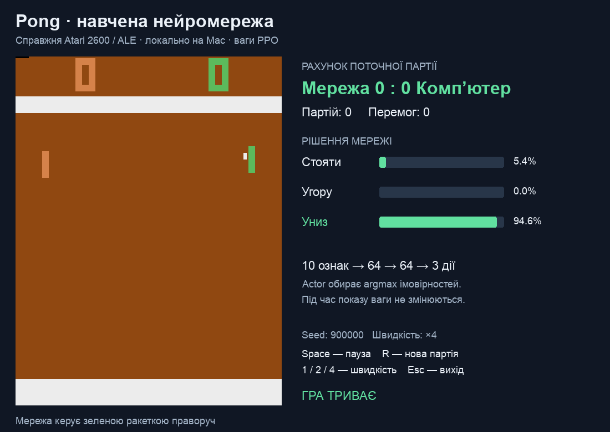

# Atari Pong — залікова робота

Личак Дмитро Романович · БЗ-123-23-1-СП  
Програмування нейронних мереж · викладач Юрій Віталійович Дегтяр

## Поточна версія для Mac

У папці **[mac-ppo](mac-ppo/)** міститься перевірена на Mac M2 версія:
нейронна мережа навчається методом **PPO** з випадкових ваг.
Вона виграла **50 із 50 незалежних тестових партій**, середній рахунок 21:9,38.
Протокол: frameskip=4, sticky actions=0,25, seeds 700000–700049;
це оцінка на цьому наборі, не гарантія всіх майбутніх ігор.

- [Короткий PDF-звіт](mac-ppo/report.pdf)
- [Код, запуск і повне пояснення](mac-ppo/README.md)
- [Навчені ваги](mac-ppo/models/pong_ppo.zip)
- [Результат кожної партії](mac-ppo/results/final-evaluation.csv)
- [Повна відеопартія 21:6, відтворення ×2](mac-ppo/results/demo.mp4)

Після завантаження репозиторію відкрийте папку `mac-ppo`, запустіть
`Встановити.command`, потім `Запустити_Pong.command`. Потрібен Python 3.12.

Інтернет потрібен для першої інсталяції; сама демонстрація працює локально.

