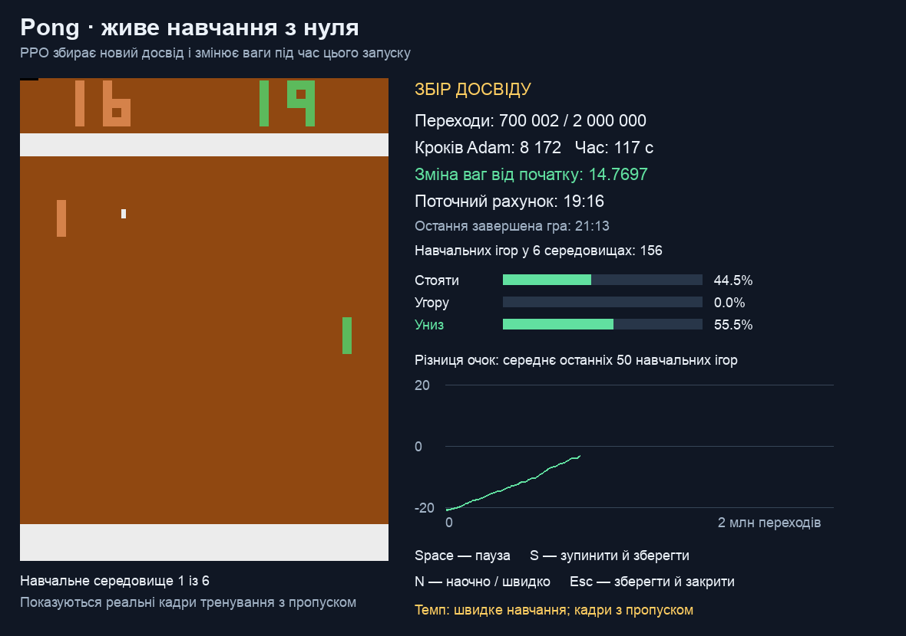
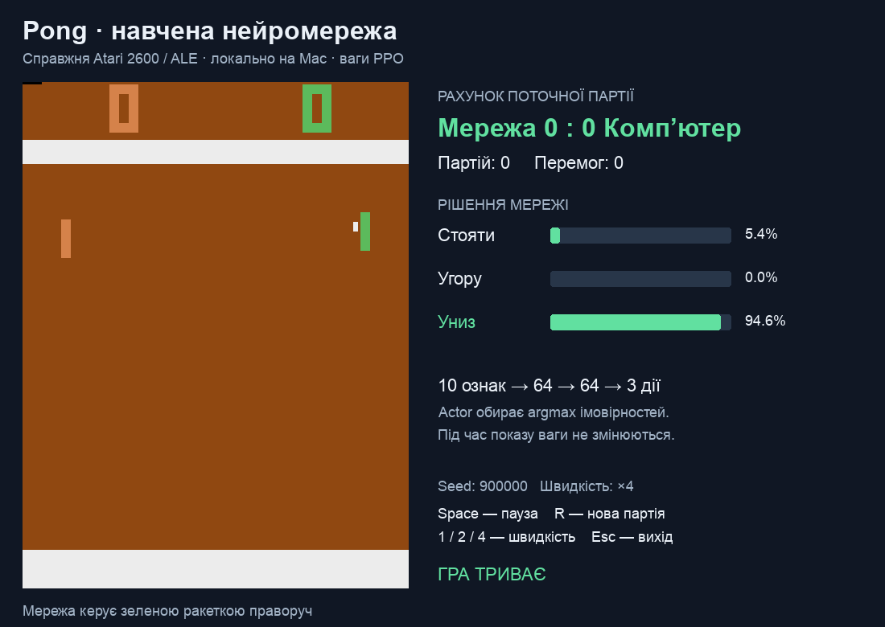
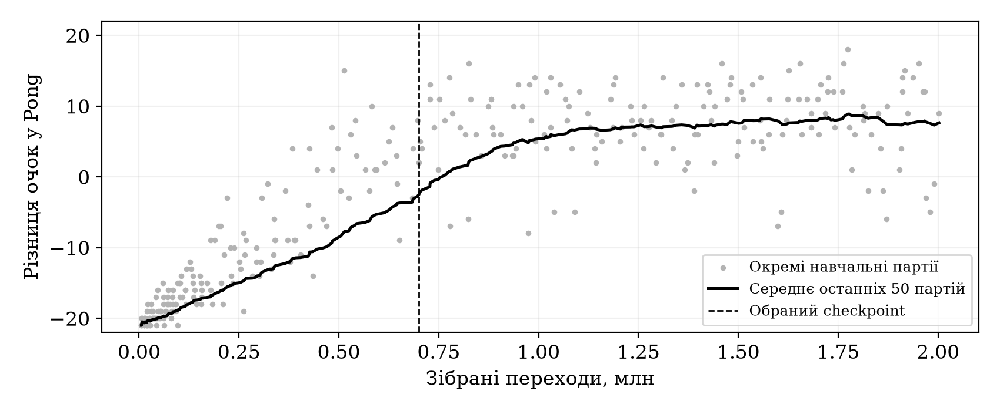
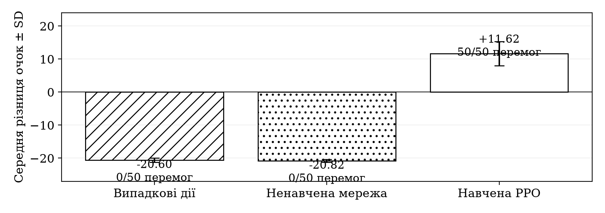

# Atari Pong на Mac — нейронна мережа PPO

**Студент:** Личак Дмитро Романович · **Група:** БЗ-123-23-1-СП  
**Предмет:** Програмування нейронних мереж  
**Викладач:** Юрій Віталійович Дегтяр

Навчений агент керує правою ракеткою у справжній Atari 2600 Pong через ALE.
Усі рішення про рух приймає нейронна мережа. Ваги навчено з випадкової
ініціалізації методом PPO на CPU Mac M2 з 8 ГБ пам’яті. Чужі готові ваги,
аналітичний прогноз відскоків та демонстратор дій не використовувалися.

## Показ саме живого навчання

Відкрийте **Почати_навчання.command**. Кожне відкриття створює новий запуск
з **випадковими вагами**: модель `models/pong_ppo.zip` не завантажується.
Вікно під’єднане до справжнього тренера PPO, а не до окремого показового агента.
Зліва — кадри навчального середовища 1 із 6; справа — кількість переходів,
реальні кроки оптимізатора Adam, L2-зміна ваг від початку та графік оригінальних
очок усіх навчальних партій. Через швидкий перебіг кадри пропускаються.

- **Space** — пауза навчання.
- **N** — наочний темп 15 кроків/с або швидке навчання. Для повного навчання
  повертайте швидкий темп: наочний режим призначений для короткого пояснення.
- **S** — зупинка та збереження поточних нових ваг.
- **Esc** — збереження й закриття.
- **Enter після завершення** — гра саме щойно навченими вагами цього запуску.

Папка кожного запуску: `runs/live_дата_час_ID/`. Вона містить `initial.zip`,
`latest.zip`, проміжні checkpoint, `episodes.csv`, `progress.csv`, `live-status.json`
і знімки навчання. Підготовлені ваги у `models/` залишаються окремо.
Початкові поразки — очікувана частина навчання. Показник L2 спочатку 0,
а після справжніх оновлень стає додатним. Нові запуски оцінюються окремо від
зафіксованого тесту 50/50 нижче.

Повний перевірочний запуск цього вікна з випадкових ваг завершив 2 002 944
переходи та 23 472 кроки Adam за приблизно 335 с на Mac M2. Початкові ваги
мали лічильник 0; їхня L2-зміна наприкінці — 22,61. Проміжна політика на
700 002 переходах збіглася за всіма тензорами з раніше незалежно перевіреною
політикою. Фактичний протокол: [live-training-check.json](results/live-training-check.json).



## Результат

**50 завершених перемог із 50 нових партій**, seeds 700000–700049.
Середній рахунок **21:9,38**; середня оригінальна нагорода **+11,62**,
вибіркове стандартне відхилення **3,68**, діапазон **+2…+18**.
Часових завершень немає. Приблизний 95% інтервал Вілсона для частки перемог:
**92,9–100%**. Це результат на цьому наборі тестів, а не гарантія всіх
майбутніх перемог.

На тих самих 50 seeds: випадкові дії — 0 перемог, середня нагорода −20,60;
ненавчена мережа — 0 перемог, −20,82. Допоміжні навчальні винагороди в усіх
цих тестах вимкнені.

[Короткий звіт PDF](report.pdf) · [Word](report.docx) ·
[Кожна тестова партія](results/final-evaluation.csv) ·
[Повна відеопартія](results/demo.mp4)



## Окремий показ підготовленої моделі на Mac

Потрібен Python 3.12. Для гри зі збереженою політикою відкрийте
**Запустити_Pong.command**.
Якщо це нове завантаження з GitHub, спочатку відкрийте **Встановити.command**
або виконайте з папки `mac-ppo`:

```bash
bash Встановити.command
bash Запустити_Pong.command
```

Під час інсталяції потрібен інтернет. Після встановлення бібліотек гра,
емулятор, ROM і збережені ваги працюють локально без інтернету.
Використовується ROM, наданий пакетом ale-py; окремо в цей репозиторій ROM не додано.

Керування показом: **Space** — пауза, **R** — нова партія,
**1 / 2 / 4** — швидкість, **Esc** або закриття вікна — вихід.
Стрілки не керують ракеткою: вона весь час керується мережею.
Типова швидкість — ×2. Діаграма справа показує ймовірності рішень Actor.

Повна резервна відеопартія `results/demo.mp4`: seed 900000, рахунок 21:6,
без вирізання фрагментів, відтворення ×2. Основна демонстрація — жива гра.

## Нейронна мережа

Поточний RGB-кадр обробляється фіксованим детектором кольорових об’єктів.
Він не прогнозує майбутні кадри та не вибирає дії. Швидкість оцінюється
за двома послідовними положеннями м’яча. Мережа отримує 10 ознак:

1. x і y м’яча;
2. vx і vy м’яча;
3. y власної ракетки та y суперника;
4. відносні y і x м’яча щодо ракетки;
5. швидкість власної ракетки;
6. видимість м’яча.

Ознаки нормовані й обмежені до [-1, 1]. Нейронний детектор зображення
та фізика гри не навчаються. Нейромережа навчає стратегію керування.
CNN не використовується; це компактний MLP.

| Частина | Архітектура | Параметри |
|---|---|---:|
| Actor | 10 → 64 → Tanh → 64 → Tanh → 3 | 5 059 |
| Critic | 10 → 64 → Tanh → 64 → Tanh → 1 | 4 929 |
| Разом | Окремі гілки Actor і Critic | 9 988 |

Actor задає категоріальний розподіл трьох дій: стояти, угору, вниз.
Навчання вибирає дії випадково з цього розподілу; тест і показ використовують argmax.
В ALE індекси NOOP/RIGHT/LEFT відповідають цим трьом рухам у Pong.
Critic оцінює очікувану дисконтовану суму винагород.

## Навчання та вибір ваг

PPO реалізовано бібліотекою Stable Baselines3 поверх PyTorch. Навчання:

| Параметр | Значення |
|---|---:|
| Seed | 42 |
| Паралельні емулятори | 6 |
| Переходи з кожного за збір | 512 |
| Загальний rollout | 3 072 |
| Мінібатч | 512 |
| Епохи на rollout | 6 |
| Оптимізатор | Adam |
| Learning rate | 0,0003 |
| Gamma / GAE lambda | 0,995 / 0,95 |
| PPO clip | 0,2 |
| Entropy coefficient | 0,01 |
| Value coefficient | 0,5 |
| Gradient norm limit | 0,5 |
| Приховані активації | Tanh |
| Числа | float32 |
| Пристрій | CPU, 1 потік PyTorch |

Один rollout містить шість мінібатчів; за шість епох Adam робить 36 кроків.
Основний запуск зібрав **2 002 944 переходи за 314 с** за журналом тренера.
Час залежить від комп’ютера та навантаження. Це окремий реальний запуск,
не оцінка швидкості на всіх Mac.

Навчальна винагорода: `5*r + 0.1*hit + gamma*Phi(next) - Phi(current)`.
`r` — оригінальна нагорода Pong +1/-1; `hit` — видиме відбиття своєю ракеткою;
`Phi = -0.5 * abs(ball_y - paddle_y) / 160` для видимого м’яча, інакше 0.
У кінцевому стані Phi=0. Вихідний рахунок та правила емулятора не змінюються.
Під час оцінювання повертається лише `r`.

Модель вибрано **до фінального тесту**, на 10 спільних validation seeds 1000–1009:

| Checkpoint | Завершені перемоги | Середня нагорода | Часових завершень |
|---|---:|---:|---:|
| 700 002 переходи | 10/10 | +12,70 | 0 |
| 1 500 000 переходів | 9/10 | +13,10 | 1 |
| 2 002 944 переходи | 9/10 | +13,00 | 1 |

Критерій — найбільше завершених перемог, за рівності — середня оригінальна
нагорода. Вибрано **700 002**, `models/pong_ppo.zip`. Усього виконано навчання
до 2 млн; останні ваги збережено окремо у `models/last_2002944.zip`.
Повторний тест не змінює ваги. Початкову ненавчену модель тієї самої архітектури
відтворено із seed 42 для базового порівняння.



На графіку — оригінальна різниця очок, хоча оптимізація використовує допоміжну
винагороду. Дії навчальної політики стохастичні; це інший режим, ніж argmax у тесті.
Довше навчання не гарантує кращої окремої моделі.

## Протокол незалежної перевірки

- ALE/Pong-v5, стандартні mode і difficulty, frameskip=4, sticky actions=0,25.
- 50 епізодів, seeds 700000–700049; однакові умови для всіх трьох політик.
- Максимум 15 000 переходів (приблизно 60 000 кадрів Atari).
- Перемога — завершена гра з більшим числом очок мережі; truncation не є перемогою.
- У тесті немає навчання, допоміжної винагороди, демонстратора, прогнозу відскоків
  чи ручного перехоплення керування.
- Це власний описаний експеримент; повна методика стандартного Atari benchmark
  з frame stacking/CNN не заявляється.



## Повторення

```bash
.venv/bin/python -m unittest discover -s tests -v
.venv/bin/python evaluate.py --model models/pong_ppo.zip --episodes 50 --seed 700000
.venv/bin/python evaluate.py --episodes 50 --seed 700000 --out results/new-random-test.json
.venv/bin/python plot_results.py
```

Нове навчання з випадкових ваг, без перезаписування демонстраційної моделі:

```bash
.venv/bin/python train.py --steps 2000000 --envs 6 --seed 42 --out runs/new_experiment
```

Або відкрийте `Почати_навчання.command` чи `Навчати_заново.command`: обидва запускають живе навчання в новій папці.
Після навчання нові ваги автоматично не замінюють перевірену демонстраційну модель.
PPO збирає дані блоками; фактичний лічильник може трохи перевищити `--steps`.
`--resume` переносить модель і оптимізатор, але починає нові середовища; це
продовження навчання, а не точне відновлення прихованого стану емуляторів.
Для штатної зупинки створіть файл `STOP` у папці поточного запуску.

На Windows/Linux можна створити Python 3.12 venv, встановити `requirements.txt`
і викликати `python play.py`; `.command` є зручними файлами саме для macOS.
Інші платформи тут окремо не перевірялися.

## Файли та відтворюваність

- `pong_ai/environment.py` — емулятор, RGB-ознаки, перетворення дій, винагороди.
- `train.py` — PPO, журнали, проміжні та початкові ваги.
- `pong_ai/live_training.py` — вікно реальних rollout і оновлень оптимізатора.
- `evaluate.py` — окремий тест без навчання й статистика.
- `play.py` — вікно живого показу; `record.py` — повна відеопартія.
- `models/` — обрані, останні та ненавчені ваги.
- `results/training-episodes.csv`, `training-progress.csv` — фактичні журнали.
- `results/training-metadata.json` — конфігурація, обраний checkpoint і SHA-256.
- `results/final-evaluation.json` та CSV — усі 50 фінальних партій.
- `results/random-baseline-50.json`, `initial-baseline-50.json` — базові політики.
- `report.pdf`, `report.docx` — короткий звіт для викладача.

SHA-256 обраного checkpoint: `88ad569e316bf6642682c9ad4d50e9ce1a3798e65e3cf12231ecd33e9865aad7`.
Версії пакетів зафіксовано у `requirements.txt` та `requirements-lock.txt`.
Однаковий seed полегшує повторення, але інша платформа/бібліотеки можуть
змінити числову траєкторію нового навчання.

## Джерела

- [Pong та інтерфейс ALE](https://ale.farama.org/environments/pong/).
- [Встановлення ALE](https://ale.farama.org/getting-started/).
- [Stable Baselines3 PPO](https://stable-baselines3.readthedocs.io/en/master/modules/ppo.html).
- [Проєкт викладача](https://github.com/YuriiDehtiar/TrainAI_Snake) і надана презентація
  SnakeAI v9: методичний приклад Actor/Critic, навчання і незалежного тесту.
  Його код, середовище Snake та ваги сюди не копіювалися.

Формат tensor streams у checkpoint адаптовано також для Python 3.12.0.
Значення ваг і дані експерименту не змінювалися.
